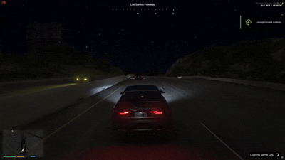

# old_vehicleFlashLight

A lightweight, standalone FiveM resource that allows players to flash their vehicle's high beams.



---

## ✨ Features

- **Hold to Flash:** High beams toggle and stay active as long as the key combination is held down.
- **Driver-Only:** Restricted to the player sitting in the driver's seat (`-1`).
- **Custom Keybind Support:** Uses FiveM's native keymapping system (`RegisterKeyMapping`). Players can rebind the key to their liking via their GTA/FiveM keybind settings.
- **Highly Optimized:** 0.00 ms idle; the thread loop only executes while the action key is actively held.
- **Standalone:** No framework dependencies (compatible with ESX, QBCore, Qbox, or standalone servers).

---

## 🎮 Default Controls

- **Flash High Beams:** `Shift` + `G` (customizable in `shared/config.lua` or in-game via *Settings > Key Bindings > FiveM*).

---

## 📦 Installation

1. Download or clone this repository.
2. Place the `old_vehicleFlashLight` folder into your server's `resources` directory.
3. Add the following line to your `server.cfg`:

```cfg
ensure old_vehicleFlashLight
```

4. Restart your server or run `refresh` and `start old_vehicleFlashLight` in the server console.

---

## ⚙️ Configuration

You can change default mapping values in `shared/config.lua`:

```lua
Config = {}

Config.defautKey = 'g'                                        -- Default key mapping
Config.defautKeyName = 'Faire un appel de phares (Shift + G)' -- Label shown in FiveM Key Bindings settings
```